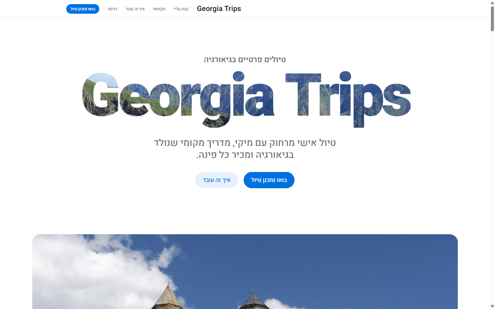
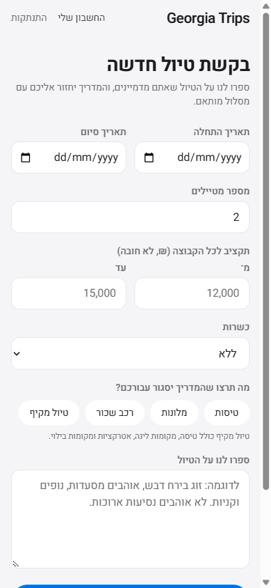
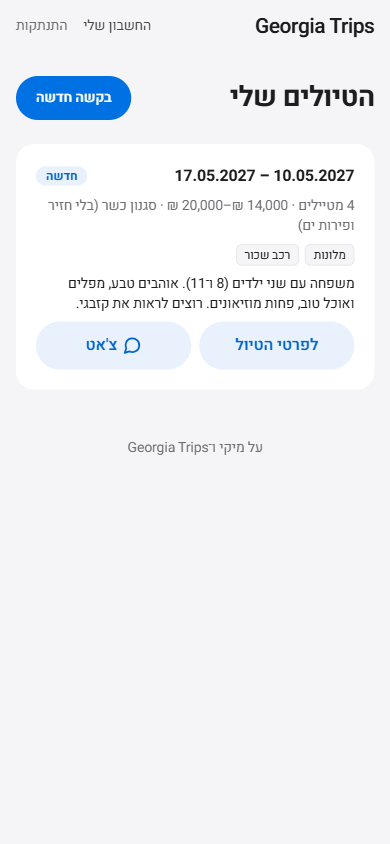
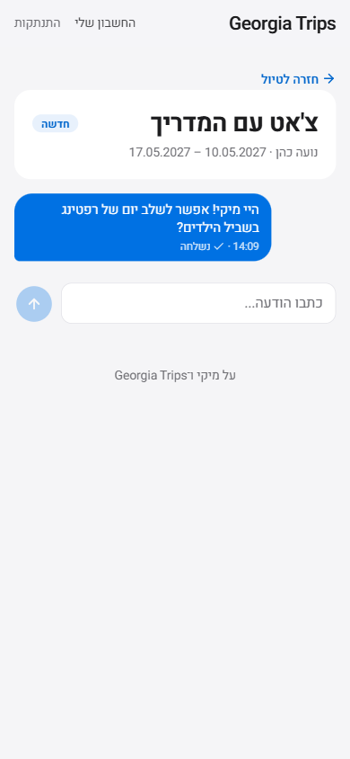
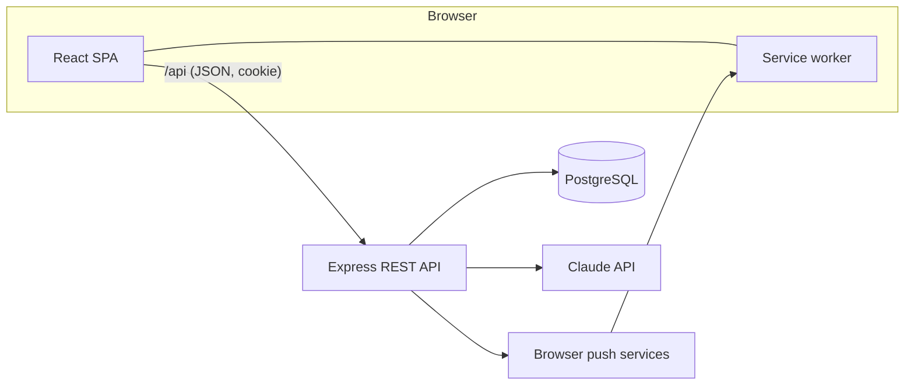
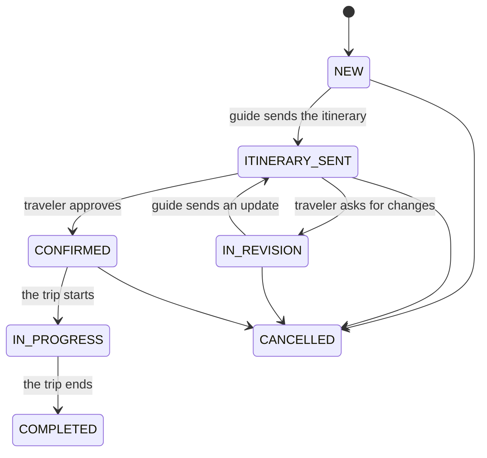

# Georgia Trips

A full-stack web app that connects travelers with a local tour guide. A traveler describes the
trip they want; the guide builds a day-by-day, hour-by-hour itinerary; they refine it together in
a built-in chat until it is confirmed; and during the trip the traveler has today's plan in their
pocket. Built for a real guide, Miki, who plans trips to Georgia (the country) for Israeli
travelers. The interface is in Hebrew, right to left.

<p align="center">
  
</p>

<p align="center">
  
  &nbsp;
  
  &nbsp;
  
</p>

## Features

**For travelers**
- Request a trip: dates, group size, budget, kosher level, and what the guide should arrange.
- Review the guide's itinerary day by day, then approve it or ask for changes.
- During the trip, a "today" view with the day's plan and an emergency (112) shortcut.
- Chat with the guide, with read receipts and unread counts.
- Leave a public review once the trip is over.

**For the guide**
- A dashboard of incoming requests, each with an AI summary: short tags and one idea for the route.
- An itinerary editor with hourly activities per day.
- AI-suggested replies in the chat, drafted on demand and always edited by the guide before sending.
- Moderation of public reviews.

**Across the app**
- Web Push notifications for new messages, even when the site is closed (service worker, VAPID).
- Animated screen changes with the View Transitions API: a trip card grows into the trip's header.
- Light and dark mode, accessible focus states, and phone-first layouts.

## Tech stack

| Layer | Technology |
| --- | --- |
| Client | React 19, TypeScript, React Router, Tailwind CSS 4, Vite |
| Server | Node.js, Express 5, TypeScript, zod |
| Database | PostgreSQL 17 (Docker), Prisma ORM with versioned migrations |
| Auth | bcrypt password hashing, JWT in an httpOnly cookie, role-based access |
| AI | Claude API (Anthropic SDK) |
| Notifications | Web Push (`web-push`, service worker, VAPID keys) |

## Architecture



- **REST API** in `server/src/routes`: auth, account, trip requests, itinerary, messages, reviews,
  push subscriptions and the guide's endpoints. Every request body is validated with zod.
- **Data model** in `server/prisma/schema.prisma`: users, trip requests, itinerary days and
  activities, messages, reviews and push subscriptions, plus the new planner's tables (below).
- **Trip lifecycle** as a state machine (`server/src/lib/tripStatus.ts`); the server rejects any
  move the table does not allow:



- **Auth**: the JWT lives in an httpOnly, SameSite cookie, out of reach of page scripts.
  Middleware checks the session and the role (`TRAVELER` / `GUIDE`) on every protected route;
  the client's route guards only decide what to show.
- **AI calls are best-effort**: the trip summary runs in the background after the request is saved,
  so a slow or failed AI call never blocks the traveler.

## Running it locally

Requirements: Node.js 22+, Docker.

```bash
# 1. Database
docker compose up -d

# 2. Server (http://localhost:4000)
cd server
npm install
cp .env.example .env        # then set JWT_SECRET (the file explains how to generate one)
npx prisma migrate dev      # creates the tables
npm run dev

# 3. Client (http://localhost:5173, proxies /api to the server)
cd ../client
npm install
npm run dev
```

The AI features and Web Push are optional: without `ANTHROPIC_API_KEY` or the VAPID keys in
`server/.env`, the app runs without them.

To make a guide account, register in the app, then:

```bash
cd server
npm run set-role -- you@example.com GUIDE
```

## In progress: an AI trip planner

The app is growing from one guide in one country into a planner for any destination. A traveler
answers a visual wizard (who is going, pace, interests, budget, mobility, food), the AI builds a
tailored itinerary from those answers, and the traveler can refine it or send it to a human guide
who covers that country. The data model for this is in place (`TripPreferences`,
`GuideDestination`, `DestinationCostEstimate`); the wizard and the generation come next.

## How it was built

Developed with AI-assisted tools (Claude Code) as a pair programmer. Every change was reviewed
and verified before it was committed: TypeScript type checking, linting, a production build, and
testing in the browser, at phone size and in dark mode.

## Licence

[MIT](LICENSE). The landing page's photographs are from Wikimedia Commons, each under its own
licence, and are credited in the landing page's footer.
